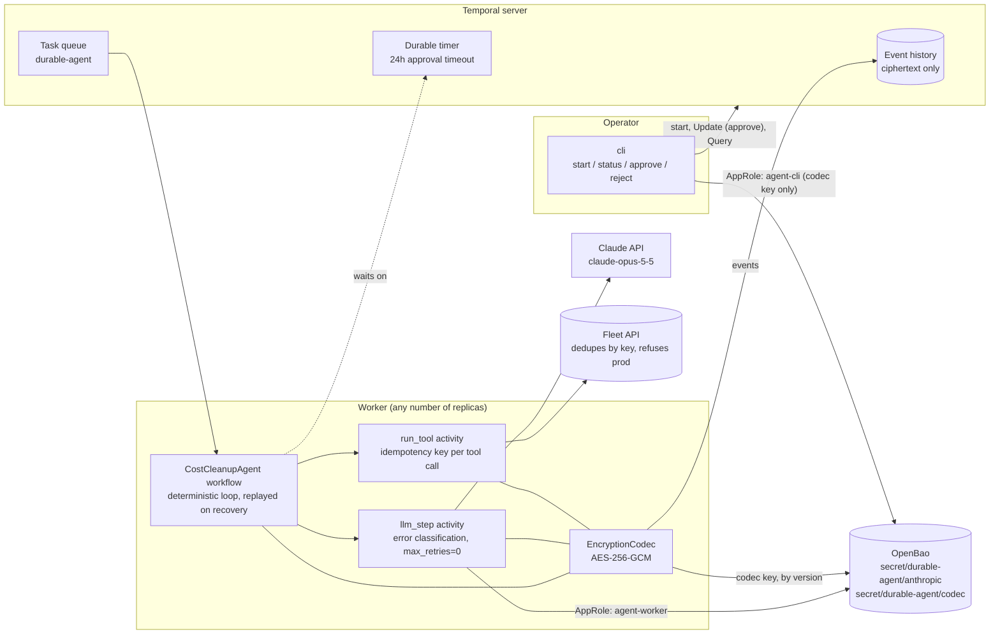

# 1. Durable agent workflows

**Goal:** an agent that keeps going when the process running it dies, waits days for a human without
holding anything open, never repeats a side effect, and never re-pays for LLM calls it already made.

You know this problem from Airflow: a DAG that dies at task 7 restarts at task 7, not task 1. Agents
need the same thing at a finer grain, because every step of an agent is an expensive, non-deterministic
LLM call or a side effect on a real system. This lesson builds it with **Temporal**, the most widely used
durable execution engine, and keeps every secret in **OpenBao**.

## Why this is the first topic

- An agent loop in a plain process loses everything on a crash, deploy or OOM kill. With ten tool calls
  per task and minutes per call, that happens a lot in production.
- Human approval is the most common production guardrail, and approvals take hours or days. A process
  can't sit in `input()` for three days; a workflow can.
- Retries are dangerous for agents: retrying "stop instance" or "send email" can do it twice. You need
  idempotency built in, not bolted on.
- Thoughtworks put *ignoring durability in agent workflows* in its Caution ring (April 2026), and Temporal
  raised at a $12.55B valuation on agent demand (September 2026). It shows up in job posts as "durable
  execution", "Temporal" or "workflow orchestration for agents".

## Core ideas in five minutes

| Idea | What it means here |
|---|---|
| **Workflow** | The agent loop. Deterministic code whose every step is recorded in an *event history*. |
| **Activity** | Anything that touches the world: the Claude call, each tool, OpenBao. Retried with backoff. |
| **Replay** | After a crash, a worker re-runs the workflow code against the history. Recorded activity results are reused, so finished LLM turns are **not** called again. |
| **Durable timer** | `wait_condition(..., timeout=24h)` costs nothing while waiting and survives restarts. |
| **Update** | A request into a running workflow that returns an answer (here: approve or reject). It has a **validator** that refuses bad input before anything is recorded. |
| **Query** | Read-only view of workflow state (here: phase, pending approvals, tokens spent). |
| **Idempotency key** | `workflow_id/tool_use_id`. Temporal runs activities *at least once*; the key lets the downstream system run them *effectively once*. |
| **Payload codec** | Encrypts every input and result before it leaves the process. The Temporal server only stores ciphertext. |

The one rule to internalise: **workflow code decides, activities do.** No network, clock, randomness or
file IO in workflow code. That is what makes replay safe.

## What you build

A cost-cleanup agent for an EC2 fleet (the same shape as your inventory data). It lists idle
instances, asks to stop the non-prod ones, waits for a human to approve each stop, stops the approved
ones and writes a summary.

```text
01-durable-agents/
  src/durable_agent/
    workflow.py      the agent loop: LLM turn, approvals, parallel tools, durable timer
    activities.py    Claude call with error classification, tools with idempotency keys
    codec.py         AES-256-GCM payload encryption, key versions from OpenBao KV v2
    fleet.py         a stand-in EC2 API with idempotent, prod-protected stops
    scripted.py      a deterministic fake Claude so everything runs without an API key
    bao.py           AppRole login and KV reads (same contract as rag-vector-srch)
    bao_bootstrap.py configure OpenBao: engines, secrets, policies, approles
    worker.py, cli.py
  tests/             workflow tests on Temporal's time-skipping server
  openbao/           server config and least-privilege policies
  compose.yaml       OpenBao + Temporal + worker (+ cli, bao-bootstrap)
```

### Production decisions worth copying

1. **Temporal owns retries.** The Anthropic client runs with `max_retries=0`. Errors are classified in
   the activity: 400/404 and auth failures are `non_retryable`, 429 honours `retry-after` through
   `next_retry_delay`, connection errors and 5xx retry with backoff. Every attempt is visible in history.
2. **History is append-only.** The assistant turn is appended exactly as Claude returned it, thinking
   blocks included. Editing earlier turns breaks prompt caching and, on current models, invalidates
   thinking blocks.
3. **Business errors are results, not failures.** "That instance is prod" goes back to the model as an
   `is_error` tool result to reason about. Only transient errors are raised for retry.
4. **Defence in depth.** The prompt says never stop prod; the fleet API refuses anyway.
5. **Least privilege.** The worker can read the model key and the codec key. The operator CLI can read
   only the codec key: it can start and approve runs but can never call Claude with your key.
6. **Key rotation without re-encryption.** The KV v2 version number is the key id stored on each
   payload. Rotate with `docker compose run --rm bao-bootstrap python -m durable_agent.bao_bootstrap --rotate-codec`; old history still
   decrypts.
7. **The workflow id is the business key.** Starting `cleanup-1` twice is refused while it runs, so
   "start" is idempotent too.

## Run it

Prerequisites: Docker, [mise](https://mise.jdx.dev). Docker is shared with your other labs, so check
first.

```bash
cd 01-durable-agents
mise trust && mise install && mise run sync
mise run test                    # 7 tests, no Docker: approvals, 24h timeout in ms, retries, codec

docker ps                        # only the shared ec2-lakehouse-* containers? then go ahead
mise run up                      # OpenBao, Temporal, bootstrap, worker
mise run demo                    # the walkthrough below
mise run down                    # free Docker when done (mise run nuke also deletes all data)
```

UIs: Temporal <http://localhost:49234>, OpenBao <http://localhost:49200/ui>.

What the demo does, and what you should see:

1. Starts the agent. It lists idle instances and proposes three stops (two dev boxes and a test box;
   the idle **prod** box is never proposed). Phase: `awaiting_approval`, `llm_calls: 2`.
2. `docker compose kill worker`: a hard kill, no graceful shutdown. Queries now fail with
   "no poller seen", but the workflow is safe in Temporal.
3. Restarts the worker. Status is back with the same pending approvals and still `llm_calls: 2`: the
   worker rebuilt state by replay, without calling the LLM.
4. Approves two stops and rejects the GPU box with a reason.
5. Result: two stops, one rejection, `llm_calls: 3` in total. Without durability a crash would have
   re-run the whole conversation.
6. The stored history: 6 activities, 3 updates, 1 timer, and `plaintext visible to the server: False`.
   The worker log shows each stop ran twice (`FLEET_FLAKY_STOPS=1` drops the first response) and the
   second attempt was deduplicated by the idempotency key.

To use the real model, put `ANTHROPIC_API_KEY=...` in a git-ignored `.env`, then
`docker compose run --rm bao-bootstrap` (copies it into OpenBao) and
`LLM_MODE=claude docker compose up -d worker`. The default model is `claude-opus-5-5` at `medium`
effort, with prompt caching on the system prompt and server-side refusal fallback enabled.

## Exercises

1. **Crash mid-activity.** Add `await asyncio.sleep(20)` inside `run_tool` for `stop_instance`, approve,
   and kill the worker during the sleep. Which activities run again after restart, and why is that safe?
2. **Break determinism.** Put `datetime.now()` in the workflow and restart a waiting run. Read the
   non-determinism error, then fix it with `workflow.now()`.
3. **Bound history.** Long agents grow history with every turn (the full conversation is in each
   `llm_step` input). Add `workflow.continue_as_new` after N turns, carrying a summary forward. Then
   try storing large tool outputs in S3 and passing only the key.
4. **Escalation.** Instead of auto-rejecting at 24h, send a reminder at 4h (a second timer) and escalate
   to a second approver.
5. **Versioning.** Change the loop (for example, approve in batches) while a run is waiting, using
   `workflow.patched("batch-approvals")`, so old runs replay the old path.
6. **Codec server.** The Temporal UI shows ciphertext. Run a small codec server (the same
   `EncryptionCodec` behind HTTP, with OpenBao auth) so authorised operators can read payloads in the UI.

## Going to production

| Laptop | Production |
|---|---|
| `temporal server start-dev` with SQLite | Temporal Cloud, or the Helm chart on Postgres with separate frontend, history and matching services, and mTLS |
| One worker container | A Kubernetes Deployment, autoscaled on task-queue backlog (Temporal exposes schedule-to-start latency) |
| AppRole secret_id file | OpenBao Kubernetes auth with the worker's service account; the codec key fetched at start and refreshed |
| `print` in the CLI | Approvals from Slack or your internal portal calling the same Update; reviewer identity from SSO |
| Logs | OpenTelemetry: Temporal's interceptor plus the GenAI spans from `agent-evals-observ`, one trace per workflow |

Other options you will hear about: **Restate** and **DBOS** (durable execution as a library on top of
your own database), **LangGraph checkpointers** (state persistence inside the framework, often run on
Temporal for the durability layer), and the AWS and Azure workflow services. The concepts above transfer
to all of them.

Sources: [Temporal LangGraph plugin and durable execution](https://temporal.io/blog/temporal-langgraph-plugin-durable-execution),
[Temporal Python SDK docs](https://docs.temporal.io/develop/python),
[what breaks when agents run in production](https://unicoconnect.com/blogs/durable-agent-workflows).

## Architecture


