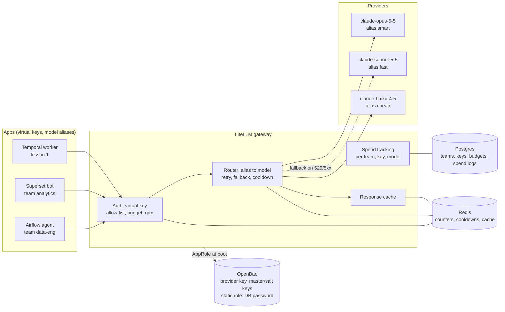

# 2. AI gateway and cost control

**Goal:** one control point in front of every model call in the company, so you can answer "who is
spending what on which model", cap it, survive a provider outage, and rotate a key without touching a
single app.

If you have run Trino behind a gateway, or put API Gateway in front of Lambdas, this is the same idea for
LLM traffic. In 2026 it matters more than ever: one agent task makes dozens of model calls, so a single
runaway loop can spend a team's monthly budget in an afternoon.

## What a gateway does

| Concern | Without a gateway | With a gateway |
|---|---|---|
| Keys | Every app holds the Anthropic key | Apps hold **virtual keys**; only the gateway holds provider keys (in OpenBao) |
| Cost | One bill, no attribution | Spend per team, key, app and model; **budgets** that block when exceeded |
| Abuse and loops | Discovered on the invoice | **Rate limits** (rpm/tpm) per key and team |
| Model choice | Model ids hard-coded in apps | Apps ask for an **alias** (`smart`, `fast`, `cheap`); the platform team decides what it maps to |
| Outages | App errors | **Retries, fallbacks, cooldowns** across models or providers |
| Repeated prompts | Paid every time | **Response cache** for deterministic calls |
| Audit | Scattered app logs | Central spend logs (metadata, not prompts, by default) |
| Guardrails | Per app, if at all | One place to add PII redaction and injection checks (lesson 3) |

The main options in 2026: **LiteLLM** (open source, Python, the most common self-hosted choice),
**Envoy AI Gateway** and **kgateway** (Kubernetes Gateway API native, pairs with lesson 4's inference
gateway), **Portkey** and **Kong AI Gateway** (open core), and managed ones from Cloudflare, Vercel and
the cloud providers. This lesson uses LiteLLM because it is the quickest to learn and run; the concepts
map one to one onto the others.

## Design decisions in this lab

1. **Aliases, not model ids.** `gateway/config.yaml` maps `smart`, `fast` and `cheap` to Opus 5.5,
   Sonnet 5.5 and Haiku 4.5. Moving every app to a new model is one config change.
2. **Prices set explicitly** per model (`model_info.input_cost_per_token`). Budgets are only as good as
   the price table, and bundled price maps lag new models.
3. **Fallback with a cooldown.** `smart` retries once, then falls back to `fast`. After 3 failures in a
   minute a deployment is cooled down for 30 s so you stop hammering an overloaded provider.
4. **Redis for shared state.** Rate-limit counters, cooldowns and the cache must be shared, or every
   gateway replica enforces its own private limit.
5. **Cache only what is safe to cache.** Exact-match caching is on by default for the demo; apps opt out
   per request with `{"cache": {"no-cache": true}}`. Never cache personalised or tool-using agent turns.
   For agents, Anthropic's prompt caching (lesson 1) saves far more than response caching.
6. **Spend metadata yes, prompts no.** `store_prompts_in_spend_logs: false`. Prompt logging belongs in
   your tracing system with its own access controls (see `agent-evals-observ`).
7. **Secrets from OpenBao, rendered at boot.** LiteLLM's built-in Vault integration needs an Enterprise
   licence (the lab hit this error first, which is worth knowing before you pitch it). The open-source
   path is `gateway/entrypoint.py`: AppRole login, read the provider key, master key and salt key, read
   the **database password from an OpenBao static role** (OpenBao owns and rotates it), put them in the
   process environment and `exec` LiteLLM. In Kubernetes, External Secrets Operator does the same job
   (you built that in the Argo CD lab).
8. **Only the gateway can read provider keys.** The `litellm` OpenBao policy is the only one with access
   to `secret/litellm/*`. Teams get virtual keys you can revoke in one API call.

## Run it

```bash
cd 02-ai-gateway
docker ps                   # Docker is shared: only the ec2-lakehouse-* containers running?
mise run up                 # OpenBao, Postgres, Redis, a fake Anthropic API, LiteLLM (~1.5 GB image)
mise run demo
mise run down
```

The demo (`demo/gateway_demo.py`) uses the normal Anthropic SDK pointed at the gateway. App code does not
change at all, apart from `base_url`, the virtual key and the alias. It walks through:

1. **Teams and keys.** `data-eng` ($5 a month: smart, fast, cheap) and `analytics` ($1 a month: fast,
   cheap). Keys: `airflow-agent` at 60 rpm, `superset-bot` at 5 rpm, `intern` with a $0.004 budget.
2. **Allow-list.** `superset-bot` asks for `smart` and is refused.
3. **Fallback.** The fake provider returns `529 overloaded` for Opus half the time. Every request still
   succeeds, and the text shows which model served it.
4. **Rate limit.** Eight quick requests on a 5 rpm key: the last ones get `429`.
5. **Budget.** The intern key's first answer goes through; once spend passes $0.004 the gateway refuses.
6. **Cache.** The same classification prompt twice: the second is served from Redis in milliseconds at
   zero cost.
7. **Spend.** Per team and per key, the numbers finance actually asks for.

To route to the real API, put `ANTHROPIC_API_KEY=...` and `ANTHROPIC_API_BASE=https://api.anthropic.com`
in a git-ignored `.env`, re-run `docker compose run --rm bao-bootstrap`, then
`docker compose up -d --force-recreate litellm`. Expect real spend: the demo makes about 25 small calls.

## Exercises

1. **Provider fallback.** Add a second `smart` deployment on Amazon Bedrock or Vertex AI (same model,
   different provider) so the alias load-balances and survives an Anthropic outage. What changes in the
   price table?
2. **Per-route effort.** Add `smart-low`: the same model with `output_config.effort: low` in
   `litellm_params`. Compare cost per *completed task*, not per request, on a few of your lesson 1 runs.
3. **Point lesson 1 at the gateway.** Give the Temporal worker a virtual key and `base_url`. Which retry
   layer should own retries now (SDK, gateway or Temporal), and why should only one of them?
4. **Budget alerts.** Configure a Slack webhook alert at 80 % of a team budget.
5. **Rotate the database password.** `bao write -f database/rotate-role/litellm`, then restart LiteLLM.
   What breaks if you forget the restart, and how would External Secrets plus a rollout fix it?
6. **Measure the overhead.** Compare p50/p99 latency through the gateway and direct. Most teams accept a
   few milliseconds; check it on your own hardware.

## Going to production

| Laptop | Production |
|---|---|
| One LiteLLM container | 2+ replicas behind your ingress, HPA on CPU and request rate, PodDisruptionBudget |
| Redis without persistence | Managed Redis/Valkey with replication (counters and cache only, losing it is survivable) |
| Postgres container | RDS/Aurora; spend logs grow quickly, so set retention or ship them to Iceberg for analysis |
| Master key in OpenBao, used by a script | SSO for the admin UI, master key only for break-glass |
| Boot-time secret rendering | External Secrets Operator syncing from OpenBao, with a rollout on change |
| Spend API | Spend logs exported to your lakehouse and a Superset cost dashboard per team |

Good next reads: [LLM gateways compared (Arize)](https://arize.com/resources/best-llm-gateways-comparison/),
[LiteLLM proxy docs](https://docs.litellm.ai/docs/simple_proxy),
[Envoy AI Gateway](https://aigateway.envoyproxy.io/).

## Architecture


