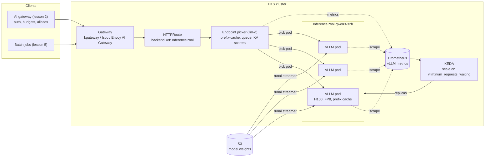

# 4. Self-hosted LLM serving on Kubernetes

**Goal:** know when self-hosting an open-weight model makes sense, size it on paper, serve it on
Kubernetes the way the 2026 stack does (vLLM, inference-aware routing, queue-based autoscaling), and
measure it with the metrics serving teams actually put SLOs on.

This is the topic where your background pays most: it is Kubernetes, GPUs, autoscaling and KubeRay,
with a new kind of workload. Most AI engineers can call an API; far fewer can run a model fleet.

## When to self-host (and when not to)

Self-host when at least one of these holds:

- **Steady, high volume of a narrow task** (classification, extraction, embedding, routing) that a small
  open model does well enough. That's where cost per token beats an API.
- **Data that can't leave your network**, or a regulator that says so.
- **Latency or availability you must control**, or fine-tuned models (lesson 9).

Don't self-host frontier-level reasoning or agent loops to save money: `mise run size` shows a 32B model
on an H100 lands around $1 to $12 per million output tokens *depending on how full you keep it*, and
that's before the on-call rota. Many teams end up hybrid: an API for the agent's reasoning and small
self-hosted models for the high-volume steps, both behind the gateway from lesson 2.

## How LLM serving works, in eight ideas

| Idea | Why it matters for you |
|---|---|
| **Prefill vs decode** | Prefill processes the whole prompt in parallel (compute-bound, sets TTFT). Decode generates one token per step (memory-bandwidth-bound, sets ITL). They stress the GPU differently. |
| **KV cache** | Attention keys and values for every token in flight. `2 x layers x kv_heads x head_dim x bytes` per token: 128 KiB for Llama 3.1 8B in BF16. Whatever memory the weights leave decides how many requests fit at once. |
| **PagedAttention** | vLLM stores the KV cache in fixed-size blocks like virtual memory pages, so there's no fragmentation and blocks can be shared. |
| **Continuous batching** | New requests join the running batch at every step instead of waiting for it to finish. This is most of the reason vLLM's throughput is so high. |
| **Prefix caching** | Requests that share a prompt prefix (system prompt, tool definitions, earlier turns) reuse its KV blocks and skip that prefill. Agent workloads are mostly shared prefix. |
| **Quantisation** | FP8 weights and KV halve memory and speed up decode on H100-class GPUs with little quality loss. INT4 goes further, with more care needed. |
| **Parallelism** | Tensor parallel splits each layer across GPUs in a node (for models that don't fit). Pipeline and expert parallel go across nodes for very large and MoE models. |
| **Disaggregation** | Separate prefill and decode pools (P/D), so long prompts don't stall everyone else's decode. llm-d and KServe support this for large models. |

Metrics: **TTFT** (time to first token), **ITL** (inter-token latency, also called TPOT), end-to-end
latency, output **tokens/s**, and **goodput** (requests per second that meet the SLO). Load balance and
autoscale on **queue depth and KV-cache use**, never CPU.

## The 2026 serving stack

```text
client ──> Gateway (Gateway API) ──> endpoint picker ──> vLLM pods (GPU)
             kgateway / Istio /       prefix-cache,       Deployment, KServe LLMInferenceService,
             Envoy AI Gateway         queue and KV aware   or Ray Serve LLM on KubeRay
```

- **vLLM** (v0.30) is the default engine; SGLang and TensorRT-LLM are the alternatives.
- The **Gateway API Inference Extension** made `InferencePool` a GA Kubernetes API: the gateway asks an
  **endpoint picker** which pod should serve each request.
- **llm-d** (CNCF Sandbox since March 2026) provides that picker and the "well-lit paths": prefix-cache
  routing, P/D disaggregation, wide expert parallelism, KV-cache offloading, SLO-aware autoscaling.
- **KServe 0.21**'s `LLMInferenceService` wraps all of it in one object.
- **Ray Serve LLM** (KubeRay) is the natural choice if you already run Ray, especially to share GPUs
  between online serving and batch inference (lesson 5).

## What is in this lesson

```text
04-llm-serving-k8s/
  src/serving_lab/
    sizing.py     memory, KV cache, concurrency, decode speed and $/M tokens for common models and GPUs
    bench.py      async load generator: agentic workload, streaming, TTFT / ITL / tok/s at each concurrency
    router.py     a small inference-aware router: round_robin vs least_loaded vs prefix_aware
    compare.py    runs the same shape of workload through each strategy, cold cache each time
  compose.yaml    three GPU-free vLLM simulators (llm-d-inference-sim) behind the router
  k8s/production/ EKS manifests: vLLM Deployment (S3 streaming, FP8, probes, PDB), InferencePool +
                  HTTPRoute, KEDA on queue depth, the same model as a KServe LLMInferenceService
                  and as a Ray Serve LLM RayService
  tests/          5 tests: the KV maths, batching economics, router stickiness and spill-over, the
                  workload shape, TTFT/ITL measured from a stream
```

## Run it

```bash
cd 04-llm-serving-k8s
mise trust && mise install && mise run sync
mise run test
mise run size          # the sizing table: no Docker needed
```

Sample of the sizing output (4k tokens of context per request):

```text
Qwen3 32B  bf16 on 1x H100 80GB  weights 61.1 GiB | KV 256 KiB/token,  36k tokens =  8 x 4k ctx | ... $11.53/M out
Qwen3 32B  fp8  on 1x H100 80GB  weights 30.5 GiB | KV 128 KiB/token, 323k tokens = 78 x 4k ctx | ... $ 1.31/M out
```

Same model, same GPU: FP8 weights and KV cache fit about ten times the concurrent requests, which is
what makes it nearly ten times cheaper per token. That one line explains most real-world serving
decisions.

The routing experiment needs Docker (three ~30 MB simulator containers and the router):

```bash
docker ps              # Docker is shared: start only when the other lab stacks are down
mise run up
mise run bench         # 48 sessions x 6 turns, 12 tenants with 1.5k-token system prompts, per strategy
mise run down
```

From a real run (each strategy gets fresh prompts, so none starts with a warm cache):

```text
48 sessions x 6 turns, 12 in flight, 12 tenants with 1500-token system prompts

round_robin                  n= 288 err=  0 | TTFT p50     497 p95    1375 ms | ITL p50  21.5 ms |     254 out tok/s
least_loaded                 n= 288 err=  0 | TTFT p50     391 p95    1224 ms | ITL p50  21.8 ms |     295 out tok/s
prefix_aware                 n= 288 err=  0 | TTFT p50     311 p95    1198 ms | ITL p50  20.9 ms |     302 out tok/s
```

Prefix-aware routing cut median TTFT by 37% against round-robin and raised throughput by 19%, on the same
three replicas. It works because each agent session keeps landing on the replica that already holds its
tenant's system prompt *and* its growing history in the KV cache: a cold 1.5k-token prefill takes about
400 ms on these simulators, a cached one about 30 ms. Its p95 is no better, because hashing 12 tenants onto
3 replicas put more load on one of them (see `picks per backend`). That's the trade-off llm-d's endpoint
picker manages with weighted prefix, queue and KV-cache scorers instead of one spill-over rule.

Two lessons from getting this to run:

- **Fair benchmarks need cold starts.** The first version reused the same prompts for every strategy, so
  whichever ran last inherited a warm cache and looked best. Each strategy now gets new prompts.
- **The simulator rejects work its KV cache can't hold** (HTTP 500) where vLLM would queue or preempt.
  The cache is sized (2048 blocks) and batch slots capped (4) so that every run completes with zero errors.

## Exercises

1. **Size your own model.** Add a model you'd actually serve (an embedding model, or a fine-tuned 8B from
   lesson 9) to `sizing.py`. What's the cheapest GPU that holds 64 concurrent 8k-token requests?
2. **Find the knee.** Run `python -m serving_lab.bench --url http://localhost:49480 --concurrency 1 4 8 16 32 64`.
   Where does TTFT p95 take off? That is your per-replica capacity, and the number your KEDA threshold
   should come from.
3. **Tune spill-over.** Set `SPILL_SLACK` to 0, 3 and 10 and re-run `compare`. Plot TTFT p50 and p95.
   Which would you choose for an interactive agent, and which for batch?
4. **Make the cache too small.** Halve `--kv-cache-size` on the simulators. Watch prefix-aware routing's
   advantage shrink as prompts are evicted, then try routing only 3 tenants per replica.
5. **Read a real deployment.** Compare `k8s/production/10-vllm-deployment.yaml` with
   `40-kserve-llmisvc.yaml`. List everything KServe creates for you, and what you lose in control.
6. **Plan a GPU node pool.** Write the Karpenter NodePool for the `p5` nodes these manifests select:
   capacity type, consolidation policy, and why GPU nodes usually shouldn't consolidate aggressively.

## Going to production

- **Cold starts dominate.** A 32B model takes minutes to load. Stream weights from S3
  (`--load-format=runai_streamer`), pre-pull images on GPU nodes, keep `minReplicaCount >= 1` for
  interactive traffic, and look at llm-d's sleep/wake and pod-snapshot guides for faster scale-up.
- **Autoscale on queue depth and KV use**, with slow scale-down: GPUs are scarce and slow to return.
- **Separate node pools and quotas** for GPUs, and protect serving from batch jobs (priority classes,
  or Kueue for batch).
- **Observe per model:** TTFT/ITL histograms, queue depth, KV-cache use, prefix-cache hit rate, and
  tokens/s per GPU dollar.
- **Security:** model servers are internal-only. Put them behind the gateway from lesson 2 for auth,
  budgets and audit; never expose vLLM directly.

Sources: [llm-d well-lit paths](https://github.com/llm-d/llm-d/tree/main/guides),
[KServe LLMInferenceService samples](https://github.com/kserve/kserve/tree/master/docs/samples/llmisvc),
[Gateway API Inference Extension](https://gateway-api-inference-extension.sigs.k8s.io/),
[KServe + llm-d + vLLM in production](https://llm-d.ai/blog/production-grade-llm-inference-at-scale-kserve-llm-d-vllm),
[llm-d-inference-sim](https://github.com/llm-d/llm-d-inference-sim),
[KubeRay Ray Serve LLM sample](https://github.com/ray-project/kuberay/blob/master/ray-operator/config/samples/ray-service.llm-serve.yaml).

## Architecture


