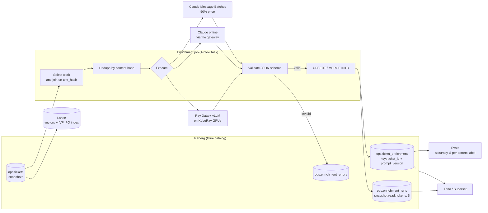

# 5. Batch AI on the lakehouse

**Goal:** run LLMs and embedding models over millions of lakehouse rows the way you run any other
production data job: incremental, idempotent, reproducible, cost-tracked, with quality measured before
you backfill.

This is the data platform engineer's edge in AI. Most "AI pipelines" in the wild are notebooks that
re-process everything, can't say which prompt produced which label, and find out the cost on the
invoice. You already know how to do better from Spark and Iceberg; this lesson adds the LLM-specific
parts.

## What changes when the transform is an LLM

| Spark habit | LLM version | In the code |
|---|---|---|
| Incremental processing | Only rows with no output for *this prompt version and model*, or whose input text changed | `enrich.py`: anti-join on `(ticket_id, text_hash)` |
| Idempotent writes | UPSERT / MERGE on `(ticket_id, prompt_version)`; re-runs never duplicate | `table.upsert(...)`, `MERGE INTO` in `jobs/spark_enrich.py` |
| Reproducibility | Every output row carries `prompt_version`, `model`, `run_id`; every run records the snapshot it read | `ops.enrichment_runs.tickets_snapshot_id` |
| Skew and shuffle | **Rate limits** are the new bottleneck: partitions x concurrency = in-flight requests | `PER_TASK_CONCURRENCY`, the gateway from lesson 2 |
| Bad records | Schema-invalid model output goes to a dead-letter table, not a failed job | `ops.enrichment_errors` |
| Dedup | Pay once per distinct input text (8% of tickets here are duplicates) | content hash cache |
| Data quality | Evals against human labels before every backfill: accuracy and $ per correct label | `evaluate.py` |
| Cost | A first-class output of every run | `est_cost_usd` per run |

Three ways to execute the same step, behind one interface (`llm.py`):

- **Anthropic Message Batches API** (`--llm claude-batch`): half price, results within 24 hours (usually
  much sooner). The right default for backfills and nightly runs. Results come back in any order, keyed
  by `custom_id`.
- **Concurrent online calls** (`--llm claude-online`, or `mapInPandas` in Spark): for small, latency-
  sensitive increments.
- **Self-hosted** with **Ray Data + vLLM** on KubeRay (`jobs/ray_enrich.py`): for very high volume on a
  small open model, with constrained JSON decoding and prefix caching. Lesson 4's sizing tells you
  whether it pays.

## Storage: Iceberg and Lance, side by side

- **Iceberg** stays the system of record: tickets, enrichment, runs and errors are Iceberg tables you can
  query from Trino and Superset, time travel, and audit. Iceberg **v3** adds features that fit AI data well:
  the **VARIANT** type for raw model or tool JSON, **row lineage** for cheap incremental processing, and
  **deletion vectors** for fast row-level updates. Use them once your engines (Spark 4 with Iceberg 1.10+,
  Trino) support v3; this lesson's tables are v2 because that's what PyIceberg writes everywhere today.
- **Lance** holds the vectors (and, in multimodal pipelines, images and audio): a columnar format built
  for random access and vector indexes stored with the data. Join back to Iceberg on `ticket_id`.

## What is in this lesson

```text
05-batch-ai-lakehouse/
  src/lakehouse_ai/
    tables.py     Iceberg catalog (local SQLite + files; Glue or REST in prod) and the four tables
    seed.py       2,000 synthetic EC2 ops tickets with gold labels, including duplicate reports
    llm.py        prompt, JSON schema, validation, prices; scripted / Batch API / online backends
    enrich.py     the incremental, idempotent enrichment job
    evaluate.py   accuracy per field, top confusions, $ per correct label
    embed.py      embeddings into Lance with an IVF_PQ index, and search
    demo.py       the whole story in one run
  jobs/
    spark_enrich.py  the same job on EMR on EKS: mapInPandas + async client + MERGE INTO
    ray_enrich.py    the same job self-hosted: Ray Data + vLLM on KubeRay, read/write Iceberg
  tests/          6 tests: incremental + idempotent, edits re-enriched in place, dead letters,
                  validation, batch pricing, embedding sanity
```

## Run it

No Docker, no services, no API key:

```bash
cd 05-batch-ai-lakehouse
mise trust && mise install && mise run sync
mise run test
mise run demo          # writes a local warehouse to .lakehouse/ (git-ignored); mise run clean resets it
```

What the demo shows (abridged, from a real run):

```text
== 1. first enrichment run (backfill)
   rows_considered=2000, rows_called=1818, rows_cached=182, inserted=2000
== 2. re-run with no new data: nothing to do, nothing paid
   rows_considered=0
== 3. 300 new tickets arrived: only those are enriched
   rows_considered=300, rows_called=276, rows_cached=24, inserted=300
== 4. one ticket edited: re-enriched and UPSERTed in place
   rows_considered=1, updated=1
== 5. evaluation against human labels
   category_accuracy 0.926, top confusion: security labelled as outage (171)
== what these 2095 calls would cost with Claude via the Batch API (50% off):
   claude-haiku-4-5 $0.75   claude-sonnet-5-5 $1.49   claude-opus-5-5 $2.99
== 6. embeddings into Lance: 2300 vectors, IVF_PQ index
== 7. time travel: ops.ticket_enrichment has 4 snapshots; the first one had 2000 rows
```

That evaluation line is the lesson in miniature. The scripted "model" is keyword rules, and it labels
*"Security group allows 0.0.0.0/0 ... please lock **down**"* as an **outage**. Without labelled data you
would never know. With it, you can try a real model, compare accuracy per dollar, and only then backfill.

To use Claude, put `ANTHROPIC_API_KEY=...` in a git-ignored `.env` and run
`uv run python -m lakehouse_ai.enrich --llm claude-batch --model claude-haiku-4-5`, then
`uv run python -c "from lakehouse_ai.evaluate import evaluate; print(evaluate('claude-haiku-4-5'))"`.
In production the key comes from OpenBao through the gateway (lesson 2), never from a file.

## Exercises

1. **Pick the model with data.** Run the Batch API path with Haiku, Sonnet and Opus on 300 tickets each.
   Compare accuracy, $ per correct label and wall time. Which would you put in production, and why?
2. **Change the prompt properly.** Fix the "lock down" confusion with a better `SYSTEM` prompt, bump
   `PROMPT_VERSION` to `triage-v2`, re-run, and compare v1 and v2 side by side from the same table.
3. **Iceberg incremental reads.** Replace the anti-join with an incremental scan between the last run's
   `tickets_snapshot_id` and the current snapshot. When is each approach right? (Hint: edits and deletes.)
4. **Ship it as a DAG.** Write the Airflow DAG: a deferrable task that submits a Message Batch and waits
   without holding a worker slot, then the MERGE, then the eval, failing the run if accuracy drops more
   than 2 points.
5. **Real embeddings.** Swap the hashing embedder for a real model (via Ray Data on GPUs, or a hosted
   embedding API) and re-run search. Then try the same tickets in the `rag-vector-srch` lab's pgvector index and compare.
6. **Spark at scale.** Run `jobs/spark_enrich.py` on EMR on EKS against a copy of real tickets through the
   gateway. Find the `PER_TASK_CONCURRENCY` where you start getting 429s, and set it 30% below.

## Going to production

- **Run on a schedule with Airflow**, one task per stage (select, submit, wait, merge, evaluate), and
  record each run in `enrichment_runs` so finance and auditors can see it.
- **Budget per pipeline** with a gateway team key; alert on `est_cost_usd` per run.
- **PII:** redact before sending (lesson 3's `guard.redact`), and keep prompts and outputs out of logs.
- **Version everything:** prompt text and schema in Git, `PROMPT_VERSION` in every row, model ids pinned.
- **Compaction and retention:** enrichment tables get many small commits; schedule Iceberg compaction
  and snapshot expiry like any other table.

Sources: [Anthropic Message Batches](https://docs.anthropic.com/en/docs/build-with-claude/batch-processing),
[Ray Data LLM](https://docs.ray.io/en/latest/data/working-with-llms.html),
[PyIceberg](https://py.iceberg.apache.org/),
[From BI to AI: Lance and Iceberg](https://lancedb.com/blog/from-bi-to-ai-lance-and-iceberg),
[Iceberg v3 features](https://iceberg.apache.org/spec/#version-3).

## Architecture


