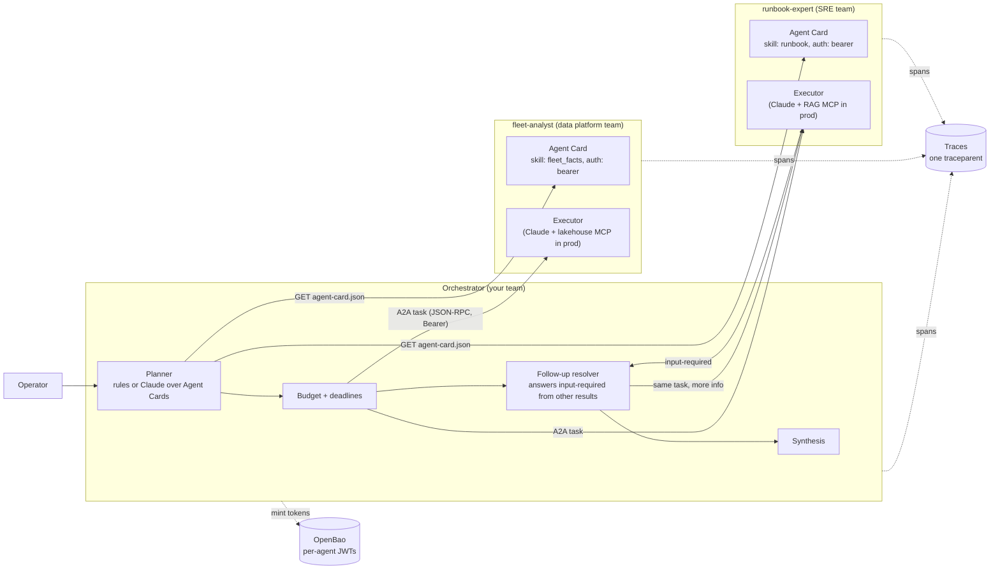

# 7. Multi-agent systems and A2A

**Goal:** know when several agents beat one, build the pattern that works in production
(orchestrator-workers), and connect agents owned by different teams with the **A2A protocol**, with the
same discipline you'd apply to any distributed system: discovery, auth, deadlines, budgets and tracing.

## First, should you?

Most of the time, no. One agent with good tools is cheaper, easier to debug, and keeps all its context in
one place. Cognition's widely read "Don't build multi-agents" makes the case: agents that can't see each
other's context make conflicting decisions. Anthropic's write-up of its multi-agent research system makes
the opposite case for a specific shape of work, and measured the cost: about **15x the tokens** of a chat.

Go multi-agent when:

- **The work fans out.** Many independent sub-questions that can run in parallel (research across sources,
  per-account analysis). Parallel subagents finish sooner and each gets a clean context.
- **Context would overflow.** Each specialist reads a lot and returns a little.
- **Ownership is split.** Another team owns the capability, its data and its prompt, and won't hand you
  their code. This is where **A2A** comes in.

Stay single-agent when steps depend tightly on each other, or when shared context matters more than
parallelism (most coding and most interactive assistants).

## MCP vs A2A

| | MCP | A2A |
|---|---|---|
| Connects | an agent to **tools and data** | an agent to **other agents** |
| The other side is | a function with a schema | an opaque peer with its own model, prompt and tools |
| Unit of work | a tool call | a **task** with a lifecycle (submitted, working, input-required, completed, failed) |
| Discovery | `tools/list` after connecting | a public **Agent Card** at `/.well-known/agent-card.json` |
| Typical boundary | inside your app | across teams or companies |

A2A started at Google (April 2025) and now lives at the Linux Foundation; spec 1.0 shipped in 2026 with
JSON-RPC, REST and gRPC bindings and signed Agent Cards.
You will use both: MCP inside each agent, A2A between them.

## What you build

An orchestrator that answers *"Which instance is hot right now, and what should I do to fix it?"* by
delegating to two remote agents owned by different teams:

- **fleet-analyst** (data platform team) knows the fleet.
- **runbook-expert** (SRE team) knows the runbooks, and answers **input-required** when it isn't told
  which instance the question is about.

The orchestrator fans out in parallel, notices the follow-up question, answers it from what
fleet-analyst found, continues the *same* A2A task, and writes the answer.

```text
07-multi-agent-a2a/
  src/multi_agent/
    specialists.py   two A2A servers (a2a-sdk 1.2): Agent Cards with skills and a bearer security scheme,
                     task lifecycle, artifacts, input-required, auth middleware
    remote.py        A2A client wrapper: card discovery, auth header, deadline, W3C traceparent, typed reply
    orchestrator.py  planner, parallel fan-out, delegation budget, follow-up resolution, synthesis;
                     ClaudePlanner lets Claude pick agents from their cards
    demo.py          runs everything locally on random ports
  tests/             6 tests: follow-up resolution on the same task, budget cap, timeout degrades
                     gracefully, auth, planner
```

### Decisions worth copying

1. **Discovery through cards, not code.** The orchestrator learns names, skills, endpoints and auth from
   each Agent Card. A team can change its agent's model or prompt without telling anyone.
2. **The card is public; everything else needs a token.** One credential per downstream agent, scoped to
   that agent's audience. In production these are short-lived JWTs minted by OpenBao (lesson 3), and the
   card can be signed so callers can verify it wasn't tampered with.
3. **Every remote call has a deadline.** A slow specialist turns into "unavailable (TIMEOUT); answer may be
   incomplete", not a hung request. The test sets a 3 s specialist against a 1 s deadline.
4. **A budget on delegations.** Multi-agent systems multiply tokens; a hard cap per request keeps a
   confused planner from fanning out forever.
5. **Resolve follow-ups before escalating.** `input-required` is the protocol's way to ask a question.
   The orchestrator answers from other agents' results when it can, continuing the same task id.
6. **One trace across all agents.** A W3C `traceparent` travels on every A2A call, so the spans from three
   services line up in one trace in your observability stack (`agent-evals-observ`).

## Run it

No Docker, no API key:

```bash
cd 07-multi-agent-a2a
mise trust && mise install && mise run sync
mise run test
mise run demo
mise run demo-claude      # optional: Claude chooses the agents from their cards (needs ANTHROPIC_API_KEY)
```

From a real run:

```text
== discovery: runbook-expert's Agent Card (public)
   name='runbook-expert' skills=['runbook'] auth=['bearer'] endpoint=http://127.0.0.1:59034/a2a/jsonrpc
   calling it without a token: HTTP 401

== question: Which instance is hot right now, and what should I do to fix it?
   span runbook-expert  TASK_STATE_INPUT_REQUIRED   0.41s  task=42d639eb
   span fleet-analyst   TASK_STATE_COMPLETED        0.42s  task=28c6f92e
   span runbook-expert  TASK_STATE_COMPLETED        0.41s  task=42d639eb
   trace 00-00211ac7a944b8bfd654c39cdc1fb4d3-9c896fd9506da93b-01  delegations used: 3

== answer
[runbook-expert] RB-12 High CPU: 1) check the top queries in Trino UI 2) scale the worker pool ...
[fleet-analyst] hot (p95 CPU > 80%): ['i-0a1b2c3d4e5f60002'] ...

== latency: parallel fan-out 0.88s vs sequential 1.29s
```

Note the runbook-expert's two spans share one task id: that's a multi-turn A2A task.

## Exercises

1. **Make the specialists real.** Put Claude behind `FleetAnalyst` with the MCP server from
   `learn-ai-agent` as its tool, and behind `RunbookExpert` with the `rag-vector-srch` MCP server. The
   orchestrator doesn't change at all. That's the point of A2A.
2. **Push notifications.** Make runbook-expert a long job (30 s) and switch the orchestrator from streaming
   to A2A push notifications with a webhook. When is that better than holding a stream open?
3. **Signed cards.** Use the SDK's agent-card signing (see the a2a-python `agent_card_signing.py` sample)
   and make the orchestrator refuse unsigned or tampered cards.
4. **Measure the multiplier.** With `--claude` and real specialists, log tokens per request for the
   orchestrator plus specialists, against a single agent with both MCP servers attached. Which wins on
   cost, latency and answer quality for your questions?
5. **Durable orchestration.** Move the orchestrator into a Temporal workflow (lesson 1) so a fan-out
   survives restarts and an `input-required` that needs a human can wait for days.
6. **Registry.** Write a tiny agent registry service that lists Agent Cards by skill tag, and make the
   planner query it instead of a hard-coded URL list.

## Going to production

| Laptop | Production |
|---|---|
| Random local tokens | Per-agent short-lived JWTs from OpenBao; audience = the agent's URL |
| Hard-coded URLs | An agent registry (or your service catalogue) indexing Agent Cards by skill |
| In-memory task store | `DatabaseTaskStore` (the SDK ships one) so tasks survive restarts |
| Printed spans | OpenTelemetry spans per delegation, with the traceparent propagated |
| Rule planner | Claude as planner, with the budget, deadlines and an eval set of routing questions |

Sources: [A2A protocol](https://a2a-protocol.org/),
[a2a-python SDK](https://github.com/a2aproject/a2a-python),
[how Anthropic built its multi-agent research system](https://www.anthropic.com/engineering/multi-agent-research-system),
[Cognition: don't build multi-agents](https://cognition.ai/blog/dont-build-multi-agents).

## Architecture


