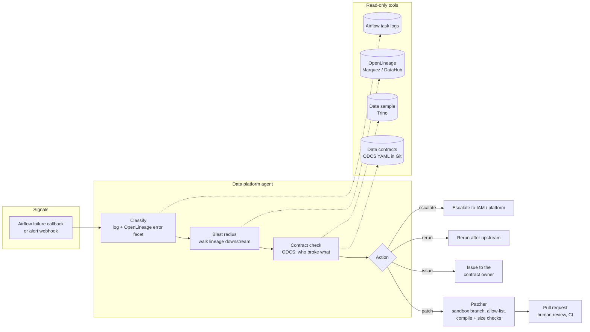

# 8. Agentic data engineering

**Goal:** put an agent to work on *your* platform: it triages failed Airflow runs at 3 am, works out the
root cause and the blast radius from **OpenLineage**, checks the **data contract** to see who broke what,
and picks the right action, opening a reviewed pull request only when a code change is actually the fix.

This lesson pulls the roadmap together on your home turf: tools and MCP (learn-ai-agent), evals
(agent-evals-observ), durable approval (lesson 1), the gateway (lesson 2), guardrails (lesson 3) and
batch AI (lesson 5).

## Why this is a high-value skill

Every data platform team has the same on-call pain: a failed DAG, a wall of Spark logs, and the question
"is this ours, theirs, or nobody's?". The investigation is mostly mechanical (read the log, walk lineage,
check the contract, check upstream runs), and that's exactly what agents do well when they have the right
tools and the right limits. The value isn't the agent writing Spark code. It's the agent getting from
"something failed" to "here's the cause, here's who is affected, here's who should act" in a minute, with
evidence.

## The two standards that make it possible

- **OpenLineage**: the open standard for lineage events. Airflow 3, Spark, dbt and Flink emit
  `START`/`COMPLETE`/`FAIL` run events with input and output datasets, schema facets and error messages.
  Marquez, DataHub and most catalogs ingest them. That gives the agent a live dependency graph without
  scraping code.
- **Data contracts** (Open Data Contract Standard, ODCS v3.2): a YAML promise from a producer about a
  dataset's schema, quality rules, SLAs and owner. When a consumer breaks, the contract tells you whether
  the producer broke its promise, and who to call.

## Choosing the action is the hard part

| What failed | Category | Right action | What a naive agent does |
|---|---|---|---|
| Executor OOM on a skewed partition | resources | **patch**: PR raising memory, enabling skew-join handling | same, but also changes the IAM role "to be safe" |
| Producer renamed a column | schema drift | **issue** to the contract owner; quarantine | patches the consumer to read the new name, silently changing semantics for everyone downstream |
| Sensor timed out | upstream late | **rerun** after upstream lands; chain to the upstream failure | bumps the timeout |
| AccessDenied on Glue | permissions | **escalate** with the minimal policy statement | edits IAM |

The scripted triage in this lesson gets all four right, and the evals check the *action* first: a correct
diagnosis with the wrong action is the failure that hurts in production.

## What is in the code

```text
08-agentic-data-eng/
  data/
    lineage/events.jsonl            OpenLineage events: 5 jobs, a Superset dashboard, 4 failures
    logs/*.log                      Airflow task logs for each failed run
    contracts/*.odcs.yaml           ODCS v3.2 contract for ec2.instances_raw (owner: cloud-inventory)
    samples/*.json                  the latest data sample (with the renamed column and a bad state value)
  repo/dags/ec2_inventory.py        the DAG the agent may propose changes to
  src/data_agent/
    platform.py     lineage graph and blast radius, task logs, contracts, contract validation
    patcher.py      sandboxed branch, allow-listed Spark keys only, compile check, diff size cap, PR body
    triage.py       classify -> blast radius -> contract -> action; chains late runs to upstream failures
    claude_agent.py the same with Claude choosing tools (strict schemas) and submitting a structured report
    evals.py        scores action, category, blast radius and owner per incident
  tests/            8 tests, including the patcher guardrails
```

### Guardrails, in code rather than in the prompt

- **The agent proposes, humans merge.** `patcher.propose` works in a throwaway clone on `agent/<run-id>`
  and returns a diff and a PR body. Nothing is pushed; in production your CI opens the PR with a bot
  identity that can't merge.
- **Allow-listed changes only.** DAG files, and only Spark tuning keys inside them. A proposal touching
  `execution_role_arn` or a Terraform file is refused (tested), however well argued.
- **Evidence travels with the change.** The PR body quotes the log lines and shows before/after values,
  so a reviewer can approve in thirty seconds or reject with a reason.
- **Read-only everywhere else.** Lineage, logs, contracts and samples are read tools. Reruns, issues and
  escalations are recommendations a human (or a Temporal approval, lesson 1) acts on.

## Run it

No Docker, no API key:

```bash
cd 08-agentic-data-eng
mise trust && mise install && mise run sync
mise run test
mise run triage
uv run python -m data_agent.evals          # 4/4 incidents, mean score 1.00
mise run triage-claude                     # optional: Claude drives the tools (needs ANTHROPIC_API_KEY)
```

From a real run (abridged):

```text
== run-oom: ec2_inventory.flatten_instances
   resources -> PATCH: Spark executors were OOM-killed on a skewed partition
   blast radius: 2 downstream datasets, 3 jobs, dashboards: ['superset://prod/fleet_cost_dashboard']
   note: one task read 2.8 GiB against a 41 MiB median: data skew, so memory alone may only delay the next failure
   proposal on branch agent/run-oom (checks passed):
      -    "spark.executor.memory": "4g",
      +    "spark.executor.memory": "8g",
      +    "spark.sql.adaptive.skewJoin.enabled": "true",

== run-late: finance.daily_ec2_cost
   upstream_late -> RERUN: Upstream ['ec2_inventory.flatten_instances'] had not produced today's data
   note: the upstream failed today in ['run-oom']: fix that first, this run will follow

== run-perm: ml.rightsizing_features
   permissions -> ESCALATE: Role lacks glue:GetTable on arn:aws:glue:eu-west-1:...:table/ml/rightsizing_features

== run-drift: ec2_inventory.flatten_instances
   schema_drift -> ISSUE: Upstream renamed `instanceType` to `instance_type` in ec2.instances_raw
   notify: cloud-inventory-oncall@acme.example
   note: also invalid values against the contract: {'state': ['stoped']}
```

Two things to notice: the finance failure is traced back to the OOM, so one fix closes two incidents; and
the schema drift goes to the producer with the contract version and the evidence, instead of a quiet
consumer-side patch.

## Exercises

1. **Real lineage.** Turn on the OpenLineage provider in a local Airflow 3 (or point `Lineage` at a
   Marquez API) and replay a real failure from your platform.
2. **Claude vs scripted.** Run `uv run python -m data_agent.evals --claude`. Where does Claude beat the
   rules (unfamiliar errors), and where does it need the system prompt tightened? Add two incidents the
   rules can't classify (a Kafka consumer lag alert, an Iceberg commit conflict) and compare again.
3. **Serve the tools over MCP.** Expose `platform.py` and `patcher.propose` as an MCP server with lesson
   3's scopes: `lineage:read`, `logs:read`, `pr:propose`. Connect Claude Code to it.
4. **Durable incident workflow.** Wrap triage in a Temporal workflow: triage, wait for an approval Update
   on the PR (or the rerun), then rerun the DAG through the Airflow REST API and confirm the next
   `COMPLETE` event.
5. **Contracts in CI.** Run `datacontract-cli` against the producer's table on every producer PR, so the
   rename in `run-drift` is caught before it ships. What does the agent still add once that exists?
6. **Learn from history.** Store every triage report in Iceberg (lesson 5) and have the agent search past
   incidents with the same error signature before investigating from scratch.

## Going to production

| Laptop | Production |
|---|---|
| Lineage from a JSONL file | Marquez or DataHub fed by the Airflow, Spark and dbt OpenLineage integrations |
| Logs from files | Airflow REST API (task logs), with secrets redacted (lesson 3's guards) |
| Patch in a temp clone | A bot opens the PR via the GitHub API; branch protection and CODEOWNERS enforce review |
| Run by hand | Triggered by Airflow failure callbacks or alert webhooks; one Temporal workflow per incident |
| Scripted rules | Claude through the gateway with a team budget, the rules kept as fast paths and as an eval baseline |

Sources: [OpenLineage](https://openlineage.io/docs/),
[Airflow OpenLineage provider](https://airflow.apache.org/docs/apache-airflow-providers-openlineage/stable/index.html),
[Open Data Contract Standard](https://bitol-io.github.io/open-data-contract-standard/),
[datacontract-cli](https://github.com/datacontract/datacontract-cli).

## Architecture


