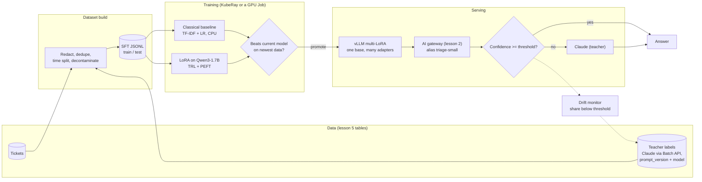

# 9. Fine-tuning and distilling small models

**Goal:** turn an expensive frontier-model step into a cheap small-model step *without losing quality*,
and know when not to bother. The technique is **distillation**: a strong model (the teacher, Claude)
labels your real data, and a small model (the student) learns from those labels.

It comes last on purpose. Most teams should exhaust better prompts, retrieval (rag-vector-srch), routing
and caching (lesson 2) and batching (lesson 5) first. Fine-tuning pays off for one shape of work: a
**narrow, high-volume, stable** task, where the savings repay the data and MLOps work.

## The decision ladder

1. **Prompt + the right model and effort level.** Often enough, and free to change.
2. **A classical model** (TF-IDF + logistic regression, gradient boosting) trained on teacher labels. For
   classification and extraction of fixed fields, this is the baseline any LLM fine-tune must beat. It
   trains in a second on CPU and serves in microseconds.
3. **LoRA on a small open model** (1 to 8B) when the task needs language ability the classical model
   lacks: free-text extraction, summaries, structured outputs over messy input.
4. **Full fine-tuning or RL**: rarely worth it outside model teams.

Whatever the student, keep the teacher in the loop with a **confidence cascade**: the student answers
when it is confident, the teacher handles the rest. You get most of the savings and keep the quality,
and it protects you when the world drifts.

## What the lesson shows

The run below uses 4,000 synthetic EC2 ops tickets with a twist: in the **last 12 days** people start
writing tickets differently (a new alerting tool, a new team, new vocabulary such as "GuardDuty finding",
"Karpenter cannot schedule", "SLO burn"). That's drift, and it's realistic.

```text
== 1. dataset hygiene
   input=4000, duplicates_removed=222, train=3143, test=635, decontaminated=0, redacted=162

== 2. accuracy on the newest 15 days (human labels)
   teacher (Claude, simulated)  0.978
   student (TF-IDF + LR, CPU)   0.811   trained on teacher labels only

== 3. cascade: the student answers when confident, otherwise the teacher does
      threshold  student share  accuracy  $ per 1k tickets
   student only        100%     0.811             0.000
           0.70         69%     0.970             0.171
           0.80         65%     0.989             0.193
           0.90         63%     0.992             0.204
   teacher only          0%     0.978             0.550

== 4. decision: threshold 0.80 keeps accuracy within half a point of the teacher (0.989) while the
   student handles 65% of tickets: 65% cheaper than sending everything to Claude.
```

Three lessons in that output:

- **Time-split or fool yourself.** A random split would have put the new vocabulary in training and shown
  the student at 99%. The time split shows the 81% you'd actually get next month.
- **The cascade beats both models alone.** Confident student answers are very accurate (they even smooth
  out the teacher's occasional mistakes), and uncertain ones go to the teacher.
- **Drift is a monitoring problem.** Watch the share of traffic falling below the threshold. When it
  grows, the world changed: relabel recent tickets with the teacher and retrain.

## What is in this lesson

```text
09-fine-tune-distill/
  src/distill/
    data.py      synthetic tickets with drift; redact, dedupe (instance ids normalised), time split,
                 decontaminate; chat-format SFT JSONL with teacher model and prompt version per row
    student.py   TF-IDF + calibrated logistic regression student; cascade sweep with cost per 1k tickets
    run.py       the whole loop, CPU, a few seconds
  jobs/
    train_lora.py         TRL SFTTrainer + PEFT LoRA on Qwen3-1.7B (GPU), assistant-only loss
  k8s/
    vllm-multi-lora.yaml  one base model serving many LoRA adapters (vLLM --enable-lora --lora-modules)
  tests/         3 tests: hygiene, SFT format, drift + cascade economics
```

## Run it

```bash
cd 09-fine-tune-distill
mise trust && mise install && mise run sync
mise run test
mise run distill        # writes .data/train.jsonl and .data/test.jsonl (git-ignored)
```

To train the LLM student on a GPU (a KubeRay worker, or any box with one L40S/A10G):

```bash
uv sync --group train
uv run python jobs/train_lora.py --model Qwen/Qwen3-1.7B --data .data/train.jsonl --out .data/lora-triage
```

Then serve it with `k8s/vllm-multi-lora.yaml` (adapter synced from S3), add it to the gateway (lesson 2)
as the `triage-small` alias, and point the cascade at it instead of the TF-IDF student.

## Exercises

1. **Beat the baseline.** Train the LoRA student and score it on `.data/test.jsonl`. Does it handle the
   new vocabulary better than TF-IDF (it should: the base model knows what GuardDuty is)? Is the gain worth
   a GPU?
2. **Close the loop.** Retrain the TF-IDF student including the first 5 days of the drifted period
   (teacher-labelled) and re-run the cascade. How much of the gap closes, and how often would you retrain?
3. **Calibrate properly.** Plot a reliability diagram for the student. What happens to the cascade if you
   remove `CalibratedClassifierCV`?
4. **Distil from real traces.** Replace `generate()` with lesson 5's `ops.ticket_enrichment` table filtered
   to one `prompt_version` and model, joined to tickets. What extra hygiene does real data need?
5. **Multi-LoRA economics.** Serve three adapters (triage, summary, extraction) on one base model with
   `--max-loras 3`. Compare GPU cost against three separate deployments using lesson 4's sizing.
6. **When the teacher changes.** Claude gets an upgrade and its labels shift on 2% of tickets. How do you
   detect it, and do you retrain the student on old or new labels?

## Going to production

| Laptop | Production |
|---|---|
| Synthetic tickets, simulated teacher | Lesson 5's enrichment tables (real inputs, Claude labels via the Batch API) |
| `.data/*.jsonl` | Versioned datasets in Iceberg or Lance, with the teacher model and prompt version per row |
| CPU student in-process | Student behind the gateway as an alias; the cascade lives in the calling service or the gateway |
| One-off training run | A scheduled RayJob: relabel, retrain, evaluate on the newest data, promote only if it beats the current model |
| Eyeballing accuracy | Track student share below threshold and cascade accuracy per day; alert on drift |

Sources: [TRL SFTTrainer](https://huggingface.co/docs/trl/sft_trainer),
[PEFT LoRA](https://huggingface.co/docs/peft/main/en/conceptual_guides/lora),
[vLLM LoRA adapters](https://docs.vllm.ai/en/latest/features/lora.html),
[Distilling step-by-step (Google Research)](https://arxiv.org/abs/2305.02301).

## Architecture


