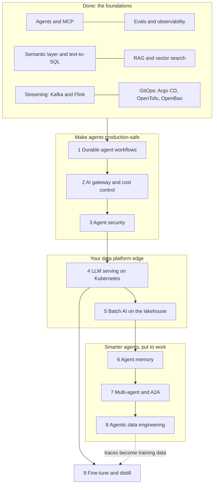

# AI + data platform roadmap (October 2026)

What to learn next, in order, for a data platform engineer who wants to be an expert in
agentic AI. Each topic has its own lesson folder with an explanation, runnable code where it
fits, and a diagram at the end. Secrets always live in **OpenBao**, as in the earlier labs.

## Already covered (not repeated here)

| Lab | What it taught |
|---|---|
| `learn-ai-agent` | Production MCP servers and Claude agents over an Iceberg lakehouse |
| `agent-evals-observ` | Tracing, eval suites, LLM-as-judge, scoring production traffic |
| `semantic-txt-2-sql` | Semantic layer (Cube) vs raw text-to-SQL vs hybrid, on Trino |
| `rag-vector-srch` | Chunking, hybrid search, reranking, RAG evals, MCP retrieval |
| `flink-learning` | Streaming with Kafka and Flink into Iceberg, alert triage agent |
| `argocd-terraform-opentofu` | GitOps with Argo CD, OpenTofu, OpenBao and External Secrets |
| `local-kubernetes`, `prod-starrocks` | Lakehouse on kind, StarRocks shared-data on EKS |

The gaps that remain are the ones that separate a working agent demo from an agent platform
a company trusts: durability, control, security, self-hosted inference, memory, multi-agent
coordination, and the data plumbing that feeds AI at scale.

## The roadmap, ranked

Ranked by **market value** (how often it shows up in senior AI / platform job posts and
architecture reviews in 2026) times **fit** (how much of your existing Spark, Kubernetes,
Ray, Iceberg and Terraform skill it reuses). Higher fit means you get to expert faster.

| # | Topic | Market value | Fit for you | Why now |
|---|---|---|---|---|
| 1 | [Durable agent workflows](01-durable-agents/) | Very high | Very high | Agents that run for hours or days need crash recovery, retries and human approval. Thoughtworks put "ignoring durability in agent workflows" in its Caution ring (April 2026); Temporal shipped a LangGraph plugin and raised at $12.55B (Sept 2026) on agent demand. It is Airflow thinking applied to agents. |
| 2 | [AI gateway and cost control](02-ai-gateway/) | Very high | High | One proxy in front of every model call: routing, failover, budgets per team, caching, rate limits and audit. Agent tasks now make dozens of calls each, so this is where cost is won or lost. |
| 3 | [Agent security](03-agent-security/) | Very high | High | Prompt injection, tool poisoning and over-privileged agents are the top blockers to production. MCP's 2026 spec hardened OAuth 2.1 authorization; you will wire it with OpenBao-issued, short-lived credentials. |
| 4 | [Self-hosted LLM serving on Kubernetes](04-llm-serving-k8s/) | High | Very high | vLLM behind KServe and llm-d (CNCF Sandbox, March 2026) with the Gateway API Inference Extension, plus Ray Serve on KubeRay. Same Kubernetes skills, new workload. |
| 5 | [Batch AI on the lakehouse](05-batch-ai-lakehouse/) | High | Very high | Embedding, classifying and extracting over millions of rows with Ray Data or Spark, written back to Iceberg v3 (VARIANT, row lineage) and Lance. This is the data platform engineer's unique edge in AI. |
| 6 | [Agent memory and context engineering](06-agent-memory/) | High | Medium | Memory failures are the most reported class of production agent bugs. Short-term state, long-term facts, compaction and file-based memory, measured with evals. |
| 7 | [Multi-agent systems and A2A](07-multi-agent-a2a/) | Medium-high | Medium | Orchestrator and worker agents, the A2A protocol between agents, and when one agent with good tools beats five. |
| 8 | [Agentic data engineering](08-agentic-data-eng/) | Medium-high | Very high | Agents that operate your platform: triaging failed Airflow DAGs, proposing fixes as PRs, guarded by data contracts and OpenLineage. Pulls every earlier topic together on your home turf. |
| 9 | [Fine-tuning and distilling small models](09-fine-tune-distill/) | Medium | Medium | LoRA fine-tuning of an open-weight model on traces from your Claude agents, for cheap, fast, narrow tasks. Useful, but most teams should exhaust prompting, RAG and routing first, so it comes last. |

Lessons are pushed in order, so a link only works once its lesson exists.

> **Status:** lesson 1 is fully tested. Lessons 2 to 4 are written and their offline tests pass; their
> Docker stacks have not had a full run yet (Docker went down mid-test) and will be verified next.

Topics 1 to 3 make agents safe to run in production. Topics 4 and 5 are where your data
platform background gives you an unfair advantage. Topics 6 to 8 make agents smarter and
put them to work on your own platform. Topic 9 is an optimisation.

## How each lesson is laid out

```text
NN-topic/
  README.md      concepts, decisions and trade-offs, then a step-by-step lab
  compose.yaml   local stack (bound to 127.0.0.1), when there is one
  mise.toml      pinned tools and tasks: mise run up / demo / down
  src/ tests/    production-quality code you can read top to bottom
```

Conventions shared with the earlier labs:

- Python 3.13 with `uv`, tools pinned with `mise`.
- **OpenBao** holds every secret. Apps get short-lived credentials (AppRole or JWT auth),
  never a key in an env var in production. A local `.env` is only for bootstrapping the
  Anthropic key into OpenBao and is git-ignored.
- Docker on the laptop is shared: run `docker ps` before `mise run up`, and `mise run down`
  when you are done.
- Run `scripts/scan-secrets.sh` before every push.

## Where the ranking came from

Sources read in October 2026:

- [Temporal: LangGraph plugin adds durable execution](https://temporal.io/blog/temporal-langgraph-plugin-durable-execution)
  and [durable agent workflows](https://unicoconnect.com/blogs/durable-agent-workflows)
- [Most in-demand AI engineering skills and salaries](https://www.secondtalent.com/resources/most-in-demand-ai-engineering-skills-and-salary-ranges/)
  and [20 agentic AI job titles for 2026](https://letsdatascience.com/news/companies-identify-20-agentic-ai-jobs-for-2026-598e685f)
- [LLM gateways compared (Arize)](https://arize.com/resources/best-llm-gateways-comparison/)
- [MCP auth hardening: the six OAuth SEPs](https://dev.to/tigeraio/mcps-auth-hardening-what-the-six-new-oauth-seps-fix-and-what-they-still-dont-2g0c)
  and [the anatomy of MCP authorization (AAIF)](https://aaif.io/blog/the-anatomy-of-mcp-authorization-how-the-hardened-flow-actually-runs)
- [KServe + llm-d + vLLM in production](https://llm-d.ai/blog/production-grade-llm-inference-at-scale-kserve-llm-d-vllm)
  and [Red Hat: KServe with llm-d](https://developers.redhat.com/articles/2026/04/21/kserve-llm-d-optimized-gen-ai-inference)
- [From BI to AI: Lance and Iceberg](https://lancedb.com/blog/from-bi-to-ai-lance-and-iceberg)
- [Context engineering and memory for production agents (ZenML)](https://www.zenml.io/llmops-database/context-engineering-and-memory-management-for-production-agent-systems)
- [OpenTelemetry GenAI semantic conventions explained (Dash0)](https://www.dash0.com/knowledge/opentelemetry-genai-semantic-conventions-explained)

## The roadmap as a picture


