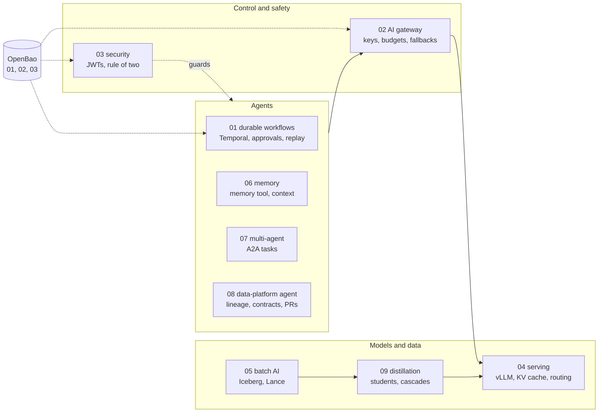

# Hands-on lab: every lesson, one component per sitting

The lessons explain the design. This track has you run each piece, predict what it will do, check, then break it on
purpose and fix it, until you could debug it on your own.

## Fresh start (do this first, every sitting)

Docker is shared with your other labs, so check before starting anything:

```bash
docker ps --format '{{.Names}}'          # start only if nothing but the ec2-lakehouse-* baseline is running
cd ~/workstuff/argocd-terraform-opentofu/ai-data-roadmap/<lesson-folder>
mise trust && mise install               # once per lesson folder
mise run reset                           # wipe that lesson's state and start it fresh
source ../lab/env.sh                     # URLs and helpers for that lesson
```

`mise run reset` per lesson:

| Lesson | `mise run reset` does | Docker |
|---|---|---|
| 01 durable agents | `docker compose down -v`, then OpenBao + Temporal + bootstrap + worker | yes, ~1 min |
| 02 AI gateway | `docker compose down -v`, then OpenBao, Postgres, Redis, fake provider, LiteLLM | yes, ~1 min |
| 03 agent security | `docker compose down -v`, rebuild, then OpenBao (identity tokens) + MCP server | yes, ~1 min |
| 04 LLM serving | `docker compose down -v`, then three vLLM simulators + router | yes, seconds |
| 05 batch AI | deletes `.lakehouse/` (Iceberg catalog, tables, Lance) | no |
| 06 agent memory | deletes `.labmem/` | no |
| 07 multi-agent | deletes `.lab-tokens`; `mise run serve` starts the agents | no |
| 08 agentic data eng | checks the fixtures are unmodified | no |
| 09 distillation | deletes `.data/` | no |

When you finish a Docker lab: `mise run down`. Every answer in these files was recorded on a stack fresh from
`mise run reset`, so your numbers should match in shape; IDs, timings and hashes will differ.

## How each lab works

1. **Look**: real commands against the running lesson, reading what each component stores, logs and sends.
2. **Predict** before you run: each step asks a question (P1, P2, …). Write your guess down first; the answers,
   with the output I got, are at the bottom of each file.
3. **Break it, then fix it**: at least one failure on purpose (a code change you revert with `git checkout`, a
   container you stop, a key you rotate), so you've seen it before it happens for real.

Read them with `glow lab/01-durable-agents.md` or in vim, with a shell beside it (tmux split works well).

| Lab | Component | You'll be able to explain | Changes anything? |
|---|---|---|---|
| [01](01-durable-agents.md) | Temporal + OpenBao | what history records; replay after a crash; non-determinism; payload key rotation | starts runs; edits code temporarily; rotates a key |
| [02](02-ai-gateway.md) | LiteLLM gateway | secret delivery; virtual keys, budgets, rate limits; fallbacks; Redis loss; password-rotation time bomb | creates keys; stops Redis; rotates the DB password |
| [03](03-agent-security.md) | MCP auth + policy | OAuth discovery; OpenBao JWTs; audience vs scope; DNS rebinding; key rotation; layered defences | rotates the signing key; edits code temporarily |
| [04](04-llm-serving.md) | vLLM serving + routing | KV maths; batching economics; prefix-cache hits; saturation; dead replicas; undersized KV cache | stops a simulator; runs a fourth |
| [05](05-batch-ai-lakehouse.md) | Iceberg + Lance pipeline | files and snapshots; incremental selection; UPSERT vs APPEND; dead letters; embedder vs index | writes the local warehouse; edits code temporarily |
| [06](06-agent-memory.md) | Memory tool backend | the six commands on disk; traversal walls; context strategies priced; stale facts | writes `.labmem/`; edits code temporarily |
| [07](07-multi-agent-a2a.md) | A2A agents + orchestrator | Agent Cards; tasks and input-required as raw JSON-RPC; budget; degrading on errors and timeouts | runs two local agents |
| [08](08-agentic-data-eng.md) | Triage agent | OpenLineage facets; blast radius; contracts; the patcher's limits; misdiagnosis | edits fixtures temporarily |
| [09](09-fine-tune-distill.md) | Distillation | dataset hygiene; time vs random splits; cascades; calibration; leakage | writes `.data/`; edits code temporarily |

Each lab is one sitting of 30-45 minutes. Do them in order if you can: later labs refer back to earlier ones (the
rule of two in 03 reappears in 06, the gateway in 02 sits in front of 04 and 05).

## Helpers (`source ../lab/env.sh` from inside a lesson folder)

| | What | Lessons |
|---|---|---|
| `$BAO_ADDR`, `$GW`, `$MCP`, `$ROUTER`, `$TEMPORAL_UI` | the lesson's local URLs (127.0.0.1, 49xxx ports) | 01-04 |
| `BAO_TOKEN=$(bao_root)` | OpenBao's root token from the bootstrap volume, into a variable (local only) | 01-03 |
| `bao PATH [curl args]` | an OpenBao API call with `$BAO_TOKEN` | 01-03 |
| `cli …`, `events WF_ID` | lesson 1's operator CLI; a workflow's event types with counts | 01 |
| `M=$(gw_master)` | the gateway's master key, into a variable | 02 |
| `mint ROLE`, `jwt_claims TOKEN` | a fresh OpenBao identity JWT; a token's decoded payload | 03 |
| `mcp_rpc TOKEN METHOD [PARAMS]` | one MCP JSON-RPC call over curl (initialize, then the call) | 03 |
| `sim N PATH`, `chat TENANT [ROUTE]` | GET on simulator N; one streamed request with a tenant prompt | 04 |
| `PYTHONPATH=src` | so `uv run python -c "from …"` finds the lesson's code | 03-09 |

None of the labs print a secret. The ones that need a key or token read it into a shell variable.

## If something is off

- **`mise run reset` stops at the bootstrap step**: OpenBao was unsealed but not yet active. Run `mise run up` again;
  the bootstraps now wait for it, so this should be rare.
- **A `uv run` command says `No module named …`**: you're not in the lesson folder, or `env.sh` wasn't sourced.
- **A lab's numbers don't match exactly**: snapshot IDs, task IDs, timings and token counts move every run. The shape
  and the reasoning should match. Anything else is worth a look.
- **You edited code during a break and forgot to revert**: `git status` in the lesson folder, then
  `git checkout -- <file>`.
- **Port already in use**: another sitting of the same lab is still running (`docker ps`, or `pkill -f multi_agent.serve`
  for lab 07).

## The lessons, with the lab that covers each part


